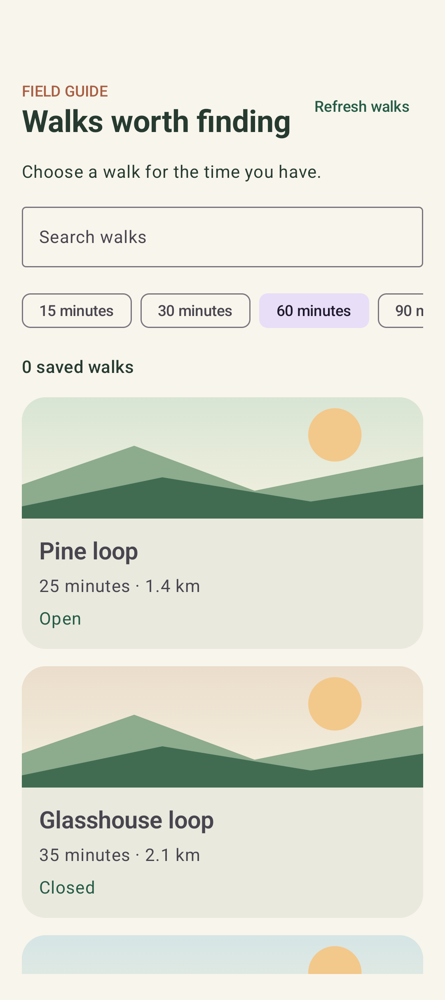
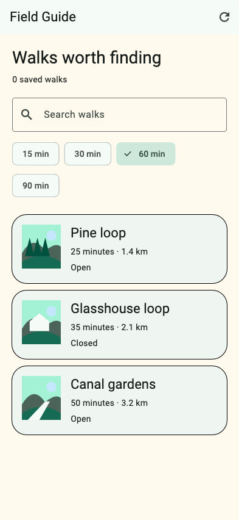
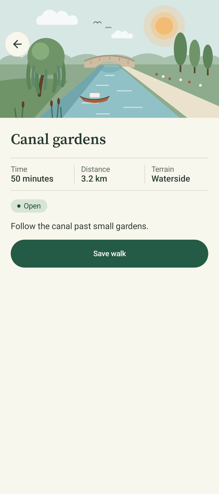
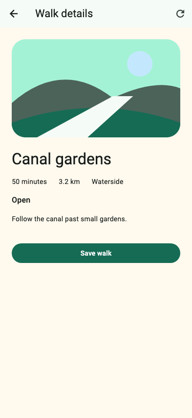
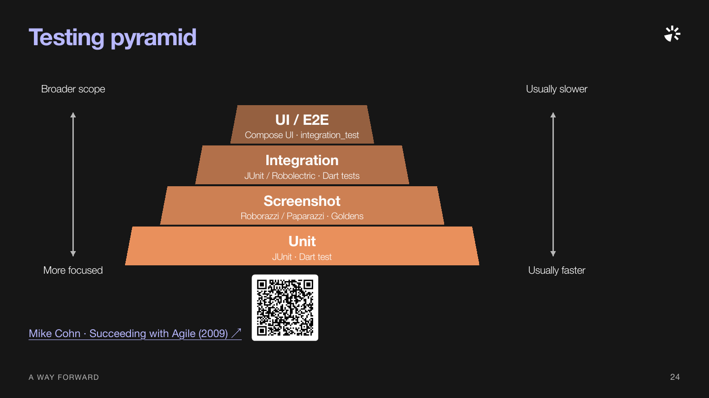
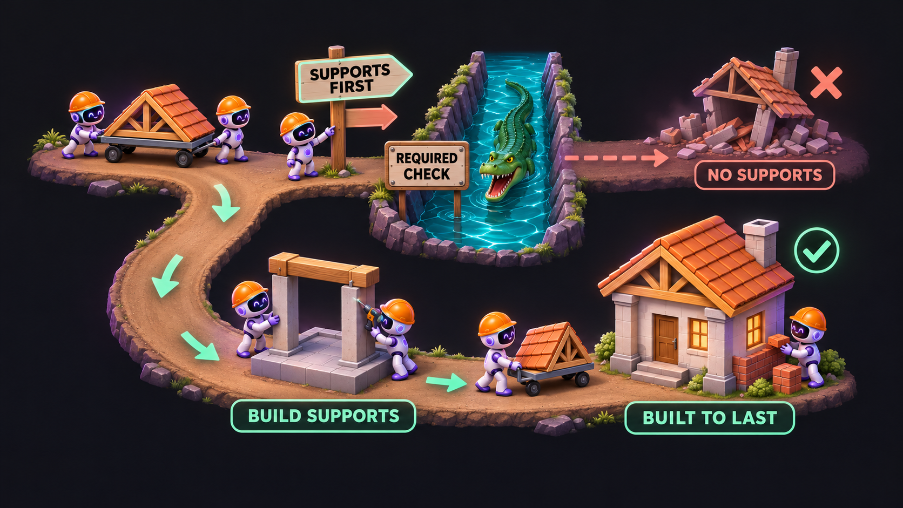
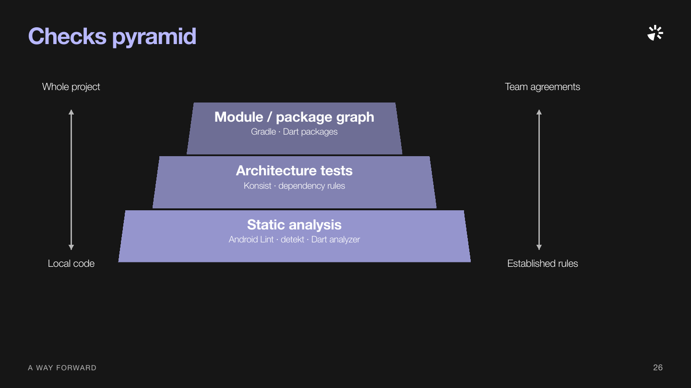

<div align="center">

# Field Guide

**A tiny app. A testing playground.**

Kotlin + Jetpack Compose · Dart + Flutter · One shared behavior contract

[Explore the tests](#take-a-tour-of-the-tests) · [Explore the checks](#signposts-and-moats) · [Run it locally](#run-it-locally)

</div>

AI can help us write code faster. We still need to know whether it works, looks right, and respects the architecture. **Field Guide keeps the app small so the tests and checks are easy to explore.** Take the patterns, adapt them to your project, and build confidence in every change.

## Meet the very small app

Browse fictional walks, filter by name and walking time, open a route, and save it for later. Two screens, bundled data, local storage. No account or backend to set up.

The same idea is implemented twice, so you can explore it in the stack you know or compare approaches across platforms.

<table>
  <tr>
    <th align="center">Android · Jetpack Compose</th>
    <th align="center">Flutter · Dart</th>
  </tr>
  <tr>
    <td align="center"><a href="docs/images/android-list.png"></a></td>
    <td align="center"><a href="docs/images/flutter-list.png"></a></td>
  </tr>
</table>

<details>
<summary>Take a closer look: route details in both apps</summary>

<table>
  <tr>
    <th align="center">Android · Route details</th>
    <th align="center">Flutter · Route details</th>
  </tr>
  <tr>
    <td align="center"><a href="docs/images/android-detail.png"></a></td>
    <td align="center"><a href="docs/images/flutter-detail.png"></a></td>
  </tr>
</table>

Android images are the latest presentation captures of the R2 app design (Android 16 emulator, light theme). Flutter images are the current checked-in golden test baselines. Both match the sample source included here.

</details>

Even a small app has promises worth protecting. **When the UI says a walk is saved, persistence must already have succeeded.** A failed write, an expired cache, or an old request finishing late gives us something meaningful to test.

## Take a tour of the tests

You do not need to install either SDK to start reading. Pick one question and follow the code.

| What do you want to learn? | Android | Flutter |
| --- | --- | --- |
| **Unit tests:** does a 60-minute filter keep a 60-minute walk and reject a 61-minute one? | [Query test](samples/android/catalog-impl/src/test/kotlin/dev/fieldguide/catalog/impl/QueryWalksTeachingTest.kt) | [Query test](samples/flutter/test/query_walks_teaching_test.dart) |
| **State and failure handling:** what happens when data expires, saving fails, or requests finish out of order? | [Domain and data tests](samples/android/catalog-impl/src/test/kotlin/dev/fieldguide/catalog/impl/DomainDataBehaviorTest.kt) · [Feature tests](samples/android/feature-catalog/src/test/kotlin/dev/fieldguide/feature/catalog/FeatureBehaviorTest.kt) | [Repository tests](samples/flutter/test/repository_test.dart) · [Controller and widget tests](samples/flutter/test/controller_widget_test.dart) |
| **Visual tests:** do loading, empty, error, light, dark, and large-text states still look right? | [Automatic Compose preview tests](samples/android/gradle/scripts/screenshot-testing.gradle) · [Device assertions](samples/android/app/src/androidTest/kotlin/dev/fieldguide/app/DeviceEvidenceTest.kt) | [Automatic Widgetbook preview tests](samples/flutter/test/preview_golden_test.dart) · [Screen goldens](samples/flutter/test/visual_golden_test.dart) |
| **Integration tests:** do the real components work together when external boundaries are controlled? | [In-process journeys](samples/android/feature-catalog/src/test/kotlin/dev/fieldguide/feature/catalog/CatalogIntegrationTest.kt) | [In-process journeys](samples/flutter/test/in_process_integration_test.dart) |
| **Device journeys:** can someone complete the flow in the running app? | [Compose UI device tests](samples/android/app/src/androidTest/kotlin/dev/fieldguide/app/DeviceEvidenceTest.kt) | [Flutter device tests](samples/flutter/apps/field_guide/integration_test/p37_test.dart) |

Both platforms share [fictional fixtures and 17 acceptance scenarios](samples/contract/README.md). Their expected results are hand-authored, independent of the production code they check.

### Start focused, then widen the scope



Use focused tests for the many small variations, then integration and device tests for the connections and important journeys. You can explore a cache boundary without sending every variation through an emulator.

This slide adapts the testing-pyramid idea attributed to Mike Cohn, *Succeeding with Agile* (2009). Its tool names illustrate options across mobile projects. In this repo, Android discovers Compose previews and verifies them with Roborazzi. Flutter discovers Widgetbook use cases for component goldens and also compares full-screen golden images. Both platforms include separate device journeys.

## Signposts and moats

**Signposts explain the way. Moats make a broken rule visible.**



A rule in a README or `AGENTS.md` helps a person or coding agent make a good choice. An executable check gives feedback when the code breaks that rule. Make those checks required in your own CI to turn guidance into a gate.

| Pattern to take with you | Where to explore it |
| --- | --- |
| Write down the architecture and product boundaries | [Agent rules](samples/AGENTS.md) and [shared behavior contract](samples/contract/README.md) |
| Check source conventions, such as theme colors and logging | [Small Python source checker](samples/harness/lint.py) and [its good/bad fixtures](samples/harness/fixtures) |
| Stop every feature from depending on any implementation, by naming convention instead of a list of modules | [Konsist import test](samples/android/app/src/test/kotlin/dev/fieldguide/app/ArchitectureTest.kt), [Gradle `checkFeatureBoundaries` task](samples/android/build.gradle.kts) and [Flutter package test](samples/flutter/test/architecture_test.dart) |
| Verify module boundaries against actual resolved dependencies | [Gradle / Pub graph checker](samples/harness/graph.py) and [negative tests](samples/harness/test_graph.py) |
| Keep fixtures and generated app assets in sync | [Contract validator](samples/contract/validate.py) and [asset checker](samples/flutter/scripts/check-generated-assets.py) |
| Run checks consistently and keep commands, exit statuses, and logs | [Local check runner](samples/harness/check.py) and [its selection tests](samples/harness/test_check.py) |



The checks pyramid is a teaching model from **New Bottlenecks: AI in Mobile Development**. It complements behavior tests by checking how code is organized. The slide shows a wider toolkit; this sample uses Konsist, a Gradle task and a Flutter test for the feature boundary, custom Python source and dependency checks, and the Dart analyzer. The included runner executes locally; CI gates are yours to configure.

## Try breaking something

Start with the linked query test in your preferred language:

1. Read the expectation: a 60-minute walk fits a 60-minute budget; a 61-minute walk does not.
2. Run the test and see it pass.
3. Change the query's inclusive duration comparison from `<=` to `<`, then run it again. The boundary test should fail.
4. Restore the comparison and run it once more.

That small loop is the point of this repo: a clear promise, a check that catches a mistake, and fast feedback while you work.

**Android**, from `samples/android`:

```sh
./gradlew :catalog-impl:test --tests '*QueryWalksTeachingTest'
```

**Flutter**, from `samples/flutter`, after the setup below:

```sh
flutter test test/query_walks_teaching_test.dart
```

## Run it locally

Just browsing? The source links above are enough. To build an app, clone the repository and choose a platform:

```sh
git clone https://github.com/makzimi/field-guide-mobile.git
cd field-guide-mobile
```

Keep the repository layout intact: both apps use the sibling `contract` and `harness` directories.

### Android

Use **JDK 17**, **Android SDK platform 36**, and **build tools 35.0.0**. Set `JAVA_HOME` and `ANDROID_HOME`, accept the SDK licenses, then open `samples/android` in Android Studio and run the app. To build from the repository root:

```sh
cd samples/android
./gradlew :app:assembleDebug
```

The APK is `samples/android/app/build/outputs/apk/debug/app-debug.apk`.

[Android setup, tests, and device commands →](samples/android/README.md)

### Flutter

Use **Flutter 3.47.7 / Dart 3.13.5**, **JDK 17**, **Android SDK platform 36**, **build tools 36.0.0**, and **NDK 28.2.13676358**. Put the pinned Flutter SDK on `PATH`, set `JAVA_HOME` and `ANDROID_HOME`, and accept the Android SDK licenses. The included Flutter host targets Android. With a device or emulator available, run from the repository root:

```sh
./samples/flutter/scripts/prepare-assets.sh
cd samples/flutter
flutter pub get
cd apps/field_guide
flutter run
```

[Flutter setup, golden tests, and device commands →](samples/flutter/README.md)

Gradle wrappers and dependency lockfiles are included. The first build needs network access to download dependencies; the apps themselves use bundled data. Release signing is not configured.

### Run shared checks with Python only

No emulator or mobile SDK needed for these checks. From the repository root, with Python 3:

```sh
python3 samples/contract/validate.py
python3 samples/contract/test_validate.py
python3 -m unittest discover -s samples/harness -p 'test_*.py'
python3 samples/harness/lint.py --all
```

<details>
<summary><strong>Run the full host suite</strong> (both mobile toolchains required)</summary>

Set `FIELD_GUIDE_JAVA_HOME` to your JDK 17 directory, `ANDROID_HOME` to your Android SDK, and `FIELD_GUIDE_FLUTTER_BIN` to the absolute path of `flutter/bin/flutter`. From the repository root:

```sh
./samples/flutter/scripts/prepare-assets.sh
cd samples/flutter
"$FIELD_GUIDE_FLUTTER_BIN" pub get
cd ../..
python3 samples/harness/check.py --full --output verification/full
```

The runner executes contract and source checks, JVM tests and generated Compose preview comparisons, Flutter tests with regenerated Widgetbook discovery, Flutter analysis, both debug APK builds, Android instrumentation compilation, resolved dependency checks, and asset checks. Each result includes its command and exit status under `verification/full`, alongside full logs.

**Device journeys run separately.** Use the commands in the platform READMEs. Building an APK or compiling its tests does not execute them on a device.

Flutter golden baselines depend on the pinned SDK and fonts. Review intentional visual changes before accepting new baselines.

</details>

---

**Keep the app small. Take the testing ideas with you.** Start with one promise in your own app and make it executable.
